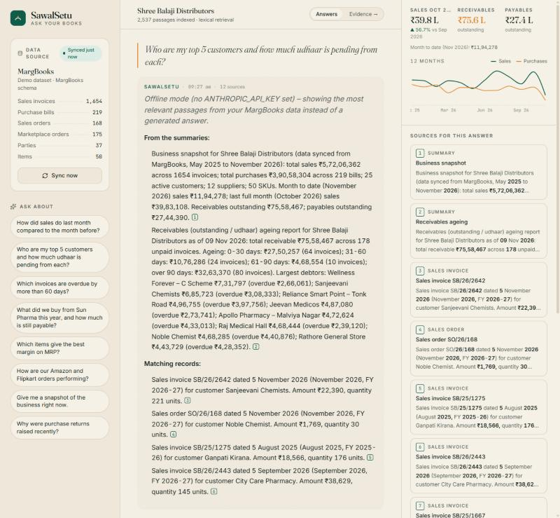

# SawalSetu · Ask your books

SawalSetu (सवाल + सेतु, "a bridge for your questions") is a retrieval-augmented assistant for
businesses that run their accounts on [MargBooks](https://margbooks.com). It pulls sales,
purchases, parties, items and marketplace orders through the **MargBooks Open API**, builds a
private search index, and answers questions in plain language with a citation for every
number. It exists because the insights built into MargBooks are shallow; this gives the owner
and the accounts team something they can actually interrogate.

```
"Who are my top customers and how much udhaar is pending from each?"
"How did sales do last month compared to the month before?"
"What did we buy from Sun Pharma this year, and how much is still payable?"
```



## How it works

```
MargBooks Open API ──► connector ──► documents ──► hybrid index ──► Claude ──► answer + citations
 (POST JSON, MB Key /     │              │              │
  Partner Id headers)     │              │              └─ BM25 (always) + optional dense vectors (Voyage / local), RRF fusion
                          │              └─ one passage per bill / order / party / item
                          │                 + pre-computed analytics passages (monthly sales, customer & supplier
                          │                   profiles, receivables ageing, e-commerce, catalogue, snapshot)
                          └─ demo mode generates the same shapes so everything runs without credentials
```

* **Backend** `backend/` – Python 3.11+, FastAPI. `app/margbooks/client.py` is the API
  connector; `app/rag/` holds document rendering, the index, query understanding and the
  Claude answer layer; `app/api/routes.py` exposes `/api/*`.
* **Frontend** `frontend/` – React 19 + Vite + Tailwind 4. Three-column "typeset ledger"
  layout: data source & suggested questions, the conversation, and an Evidence panel with
  KPIs, a 12-month trend and the passages behind the current answer. Citations in the answer
  highlight their source card on hover.
* **Design** `docs/STITCH_PROMPT.md` – the Google Stitch prompt and the design tokens the UI
  implements.

### Why analytics passages?

Plain RAG over raw invoice rows is bad at aggregates ("total sales in October"). At sync time
we materialise the aggregates a distributor actually asks about and index them as passages
alongside the raw records. Retrieval reserves half of the context for these summaries and half
for specific records, so the model can quote a verified total *and* the invoices behind it.

## MargBooks Open API (what the connector calls)

Documentation portal: <https://openapiweb.margbooks.com>. Production base URL
`https://openapi.margbooks.com/`, sandbox `https://uatopenapi.margbooks.com/`. Every call is a
`POST` with a JSON body and the headers `MB Key` and `Partner Id` (issued by
`identity/v1/auth/signup`). Responses use the envelope
`{"data": [...], "statusCode": 200, "errorCode": 0, "message": "Success"}`.

| Dataset           | Endpoint                               | Body                              |
| ----------------- | -------------------------------------- | --------------------------------- |
| Sale bills        | `masters/v1/bills/salebills`           | `fromDate`, `toDate`, `ledgerId?` |
| Sale orders       | `masters/v1/bills/saleOrders`          | same                              |
| Sale challans     | `masters/v1/bills/salechallans`        | same                              |
| Purchase bills    | `masters/v1/bills/purchasebills`       | same                              |
| Purchase orders   | `masters/v1/bills/PurchaseOrders`      | same                              |
| Purchase challans | `masters/v1/bills/PurchaseChallans`    | same                              |
| Purchase returns  | `masters/v1/bills/prList`              | same                              |
| Ledgers (parties) | `masters/v1/Account/listledger`        | `{}`                              |
| Single ledger     | `masters/v1/Account/getledger`         | `uniqueId`                        |
| Items             | `masters/v1/products/list`             | `pageNumber`, `pageSize`          |
| Stores            | `masters/v1/store/list`                | `{}`                              |
| HSN / Units       | `masters/v1/hsn/list`, `masters/v1/inventory/allUnits` | `{}`              |
| Marketplace orders| `orders/v1/Orders/list`                | `fromDate`, `toDate`, `filterBy`, `FullfillMentLocation`, `status` |

The connector tolerates modules that are not enabled for an account (it logs and continues).

## Run it

### 1. Backend

```bash
cd backend
python -m venv .venv
.venv/Scripts/activate        # Windows   |   source .venv/bin/activate on macOS/Linux
pip install -r requirements.txt
cp ../.env.example ../.env    # then edit
uvicorn app.main:app --reload --port 8000
```

On first start in demo mode the server syncs the built-in dataset automatically. In live mode
set `MARGBOOKS_MODE=live`, `MARGBOOKS_MB_KEY`, `MARGBOOKS_PARTNER_ID` and press **Sync now** in
the UI (or `POST /api/sync`).

### 2. Frontend

```bash
cd frontend
npm install
npm run dev                   # http://localhost:5173, proxies /api to :8000
```

`npm run build` writes `frontend/dist`, which the backend serves at `/` when present, so a
single `uvicorn` process can host the whole app in production.

### 3. Claude

Set `ANTHROPIC_API_KEY` in `.env`. Default model is `claude-opus-5-5` with adaptive thinking
at `CLAUDE_EFFORT=medium`; responses stream over SSE. Without a key the app runs in **offline
mode**, returning the best-matching passages instead of a generated answer, which is useful
for checking retrieval on its own.

### Optional dense embeddings

Lexical BM25 retrieval runs out of the box. For semantic matching set
`EMBEDDINGS_PROVIDER=voyage` with a `VOYAGE_API_KEY`, or `EMBEDDINGS_PROVIDER=local` after
`pip install sentence-transformers`. Vectors are fused with BM25 using reciprocal rank fusion.

## API

| Method | Path               | Purpose                                              |
| ------ | ------------------ | ---------------------------------------------------- |
| GET    | `/api/status`      | mode, model, document count, last sync, dataset counts |
| POST   | `/api/sync`        | pull from MargBooks (or demo) and rebuild the index  |
| GET    | `/api/metrics`     | KPIs for the Evidence panel                          |
| GET    | `/api/search?q=`   | raw retrieval results (debugging)                    |
| POST   | `/api/chat`        | `{question, history}` → SSE events `sources`, `token`, `done`, `error` |
| GET    | `/api/suggestions` | starter questions                                    |

## Project layout

```
backend/
  app/config.py            environment-driven settings
  app/margbooks/client.py  MargBooks Open API connector
  app/margbooks/demo.py    demo dataset in MargBooks shapes
  app/rag/documents.py     record → passage rendering + analytics passages + KPIs
  app/rag/index.py         BM25 + dense hybrid index, two-tier ranking
  app/rag/query.py         "last month", "this FY" → explicit month labels
  app/rag/llm.py           Claude streaming answerer, offline fallback
  app/rag/pipeline.py      sync / retrieve / answer orchestration
  app/api/routes.py        FastAPI routes (SSE chat)
frontend/src/
  App.tsx                  state, streaming, citation ↔ source linking
  components/Sidebar.tsx   data source card, suggested questions
  components/Conversation.tsx  editorial message layout + composer
  components/EvidencePanel.tsx KPIs, trend chart, source cards
docs/STITCH_PROMPT.md      design prompt + tokens
```

## Roadmap

* Line-item level data once MargBooks exposes bill details (the list endpoints return headers only)
* Scheduled incremental sync (`filterBy` updated date) instead of full window pulls
* Hindi / Hinglish answers toggle
* Export an answer with its evidence as a PDF or WhatsApp message
